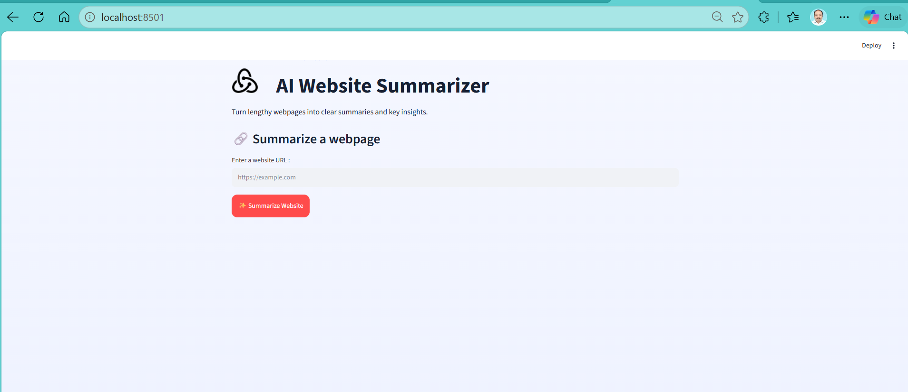
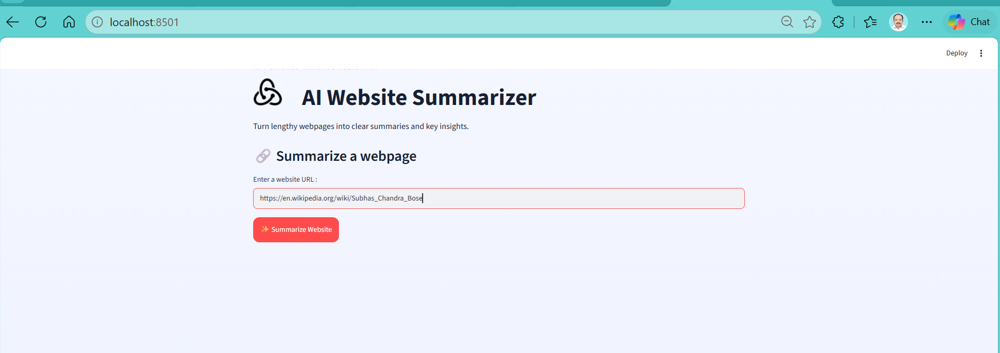
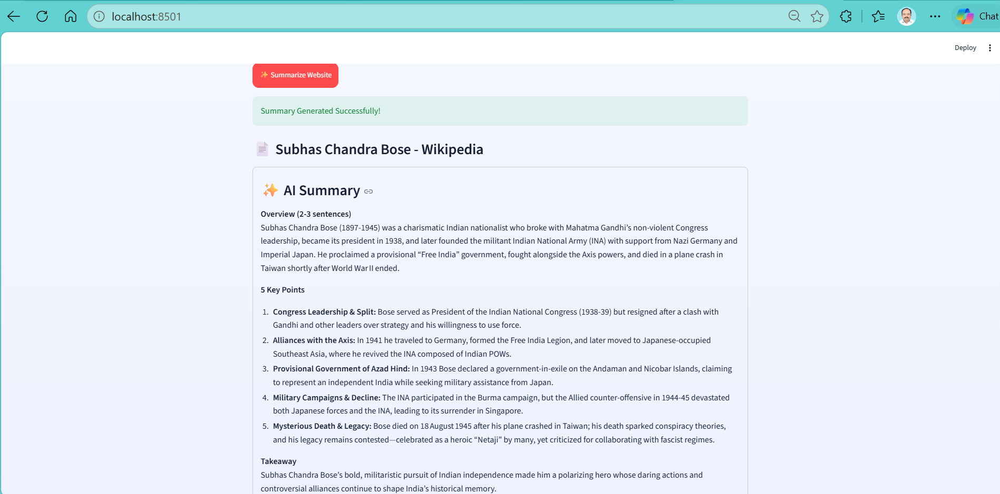
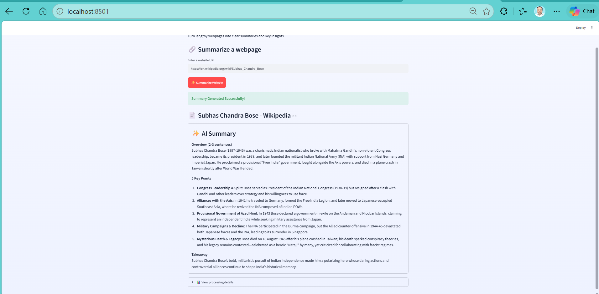

# 🤖 AI Website Summarizer

An AI-powered web application built with **Python and Streamlit** that extracts content from webpages and generates concise, structured summaries using a **Groq-hosted LLM**.

The application is designed to turn lengthy webpage content into an easy-to-read summary containing an overview, key points, and a final takeaway.

---

## 📸 Application Preview

### 🏠 Home Screen



### 🔗 Website URL Input



### 🤖 AI Generated Summary



### 🖥️ Full Application



---

## ✨ Features

- 🌐 **Website Content Extraction**
  - Accepts a webpage URL from the user.
  - Downloads and processes webpage content using `Requests` and `BeautifulSoup`.

- 🤖 **AI-Powered Summarization**
  - Uses a Groq-hosted LLM to summarize extracted webpage content.
  - Generates a structured and easy-to-understand response.

- 📋 **Structured Summary**
  - Short overview in 2–3 sentences
  - 5 key points
  - One-sentence takeaway

- 🔗 **URL Validation**
  - Checks whether the user has entered a valid HTTP/HTTPS URL.

- 📊 **Processing Details**
  - Displays the number of characters analyzed.
  - Displays the source URL.

- 🎨 **Custom Streamlit Interface**
  - Custom CSS styling
  - Gradient-based application background
  - Custom application icon
  - Responsive wide layout
  - Clean summary presentation

- 🔐 **Secure API Configuration**
  - API credentials are loaded from environment variables.
  - Secrets are kept outside the source code.

---

## 🏗️ Application Architecture

```text
                    ┌──────────────────────┐
                    │      User Input      │
                    │     Website URL      │
                    └──────────┬───────────┘
                               │
                               ▼
                    ┌──────────────────────┐
                    │   Streamlit UI       │
                    │   URL Validation     │
                    └──────────┬───────────┘
                               │
                               ▼
                    ┌──────────────────────┐
                    │   Web Scraper        │
                    │ Requests +           │
                    │ BeautifulSoup        │
                    └──────────┬───────────┘
                               │
                               ▼
                    ┌──────────────────────┐
                    │ Extracted Web Content│
                    │ Title + Text         │
                    └──────────┬───────────┘
                               │
                               ▼
                    ┌──────────────────────┐
                    │ AI Summarization     │
                    │ Groq API / LLM       │
                    └──────────┬───────────┘
                               │
                               ▼
                    ┌──────────────────────┐
                    │ Structured Summary   │
                    │ • Overview           │
                    │ • Key Points         │
                    │ • Takeaway           │
                    └──────────────────────┘
```

---

## 🛠️ Technology Stack

| Technology | Purpose |
|---|---|
| **Python** | Application development |
| **Streamlit** | Interactive web interface |
| **Requests** | Fetch webpage content |
| **BeautifulSoup** | HTML parsing and text extraction |
| **OpenAI Python SDK** | LLM API interaction |
| **Groq API** | AI inference |
| **python-dotenv** | Environment variable management |
| **HTML/CSS** | UI customization |

---

## 📁 Project Structure

```text
AI Website Summarizer/
│
├── assets/
│   └── screenshots/
│       ├── 01-home.png
│       ├── 02-url-input.png
│       ├── 03-summary_result.png
│       └── 04-full_app.png
│
├── icons/
│   └── icon_title.png
│
├── app.py
├── scraper.py
├── summarizer.py
├── test_pipeline.py
├── requirements.txt
├── .gitignore
└── README.md
```

### File Description

**`app.py`**

Main Streamlit application responsible for:

- Page configuration
- UI rendering
- URL input
- URL validation
- Calling the scraper
- Calling the summarization module
- Displaying the generated summary

**`scraper.py`**

Responsible for:

- Sending HTTP requests
- Parsing webpage HTML
- Extracting the page title
- Removing unnecessary HTML elements
- Extracting webpage text

**`summarizer.py`**

Responsible for:

- Loading environment variables
- Connecting to the Groq API
- Sending webpage content to the LLM
- Generating the structured summary

**`test_pipeline.py`**

Used to test the application pipeline and verify the core functionality.

---

## ⚙️ Installation

### 1. Clone the repository

```bash
git clone <your-github-repository-url>
cd AI-Website-Summarizer
```

### 2. Create a virtual environment

```bash
python -m venv .venv
```

### 3. Activate the virtual environment

#### Windows

```powershell
.venv\Scripts\activate
```

#### Linux / macOS

```bash
source .venv/bin/activate
```

### 4. Install dependencies

```bash
pip install -r requirements.txt
```

---

## 🔐 Environment Configuration

The application uses an API key stored in an environment variable.

Create a `.env` file in the project root:

```text
grok_api_key=YOUR_API_KEY_HERE
```

**Never commit `.env` or your API key to GitHub.**

The `.gitignore` file is configured to keep environment files and local virtual environments out of the repository.

---

## ▶️ Run the Application

Start Streamlit with:

```bash
streamlit run app.py
```

Then open the URL displayed by Streamlit, normally:

```text
http://localhost:8501
```

---

## 🔄 Application Workflow

1. User enters a website URL.
2. Application validates the URL.
3. `scraper.py` sends an HTTP request.
4. BeautifulSoup parses the webpage.
5. Unnecessary HTML elements such as scripts, navigation, headers, footers, and styles are removed.
6. Relevant webpage text is extracted.
7. Extracted text is sent to the Groq-hosted LLM.
8. The model generates:
   - A short overview
   - Five key points
   - A one-sentence takeaway
9. The result is displayed through the Streamlit interface.

---

## 🧪 Testing

The project includes:

```text
test_pipeline.py
```

Run the test file using:

```bash
python test_pipeline.py
```

You can also test the individual modules independently.

---

## 🧠 Key Learning Outcomes

This project demonstrates practical experience with:

- Python application development
- Web scraping
- HTML parsing
- REST/API integration
- LLM integration
- Prompt engineering
- Environment variable management
- Streamlit application development
- Custom CSS styling
- Error handling
- Modular Python development
- Git/GitHub project management

---

## 🚀 Future Enhancements

Potential improvements include:

- 📄 PDF document summarization
- ▶️ YouTube transcript summarization
- 📑 Multiple summary length options
- 💾 Export summaries to PDF
- 📋 Copy-to-clipboard functionality
- 🕘 Summary history
- 🌍 Support for additional content sources
- 📊 Token and processing statistics
- 🔎 Source content preview
- 🔐 Improved API error handling

---

## ⚠️ Limitations

The application currently works best with publicly accessible webpages.

Some websites may not be accessible because of:

- Authentication requirements
- Robots restrictions
- JavaScript-rendered content
- Anti-bot protection
- Network restrictions

---

## 🙏 Acknowledgements

I would like to express my sincere gratitude to **Shivank Agarwal and all my mentors at Scaler Institute** for their exceptional guidance, support, encouragement, and continuous feedback throughout my learning journey.

Their mentorship has been instrumental in helping me develop a stronger foundation in **Data Analytics, Python, SQL, Statistics, Machine Learning, and problem-solving**, while also encouraging me to apply these concepts through practical projects.

I am especially grateful for the patience, constructive feedback, and practical guidance provided throughout the learning process. The knowledge and confidence I have gained through this journey have motivated me to continuously learn, build, and improve.

I would also like to thank the **Scaler faculty, instructors, mentors, and the entire Scaler learning community** for creating an environment that encourages curiosity, hands-on learning, and professional growth.

**Thank you to all my mentors for being an important part of my journey into Data Analytics. 🙏**

## 👨‍💻 Author

**Ram**

Data Analyst | Data Science Enthusiast | Python | SQL | AI

---

## ⭐ Project Purpose

This project was developed as a practical demonstration of integrating **Python, web scraping, APIs, LLMs, and Streamlit** into a complete end-to-end AI application.

If you find the project useful, feel free to ⭐ the repository.